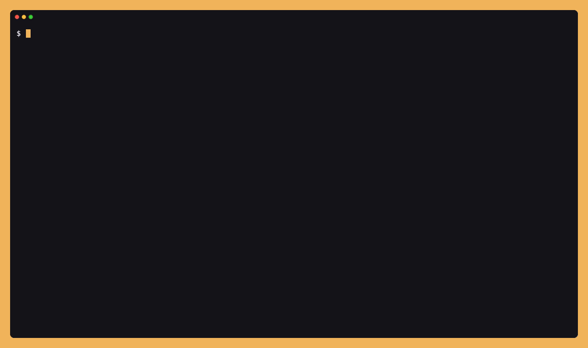
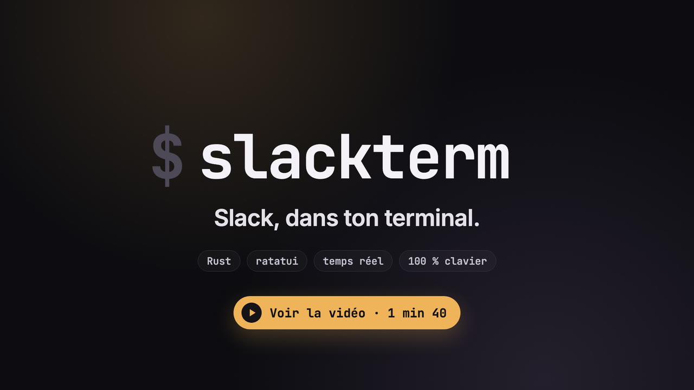
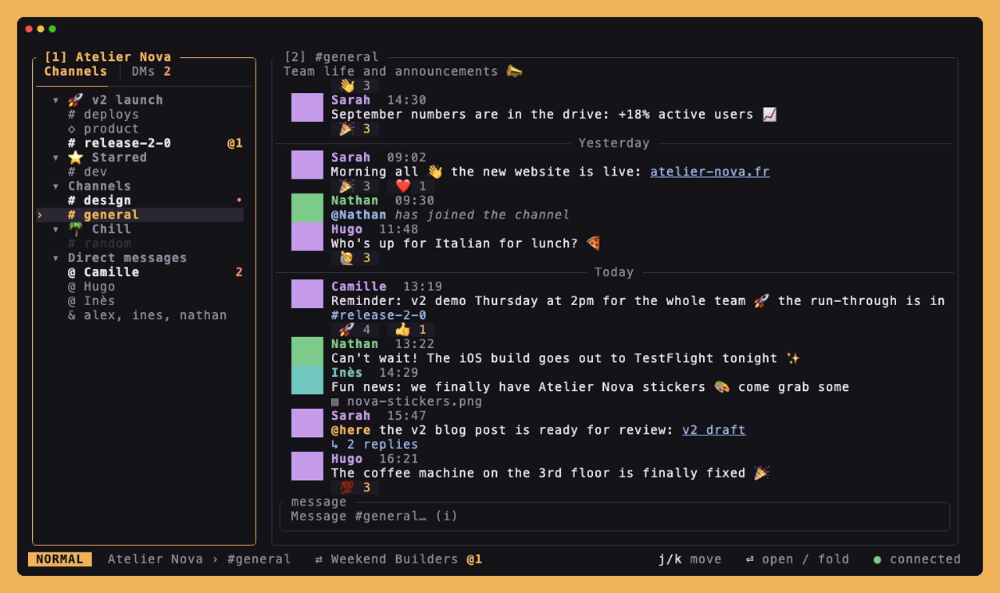
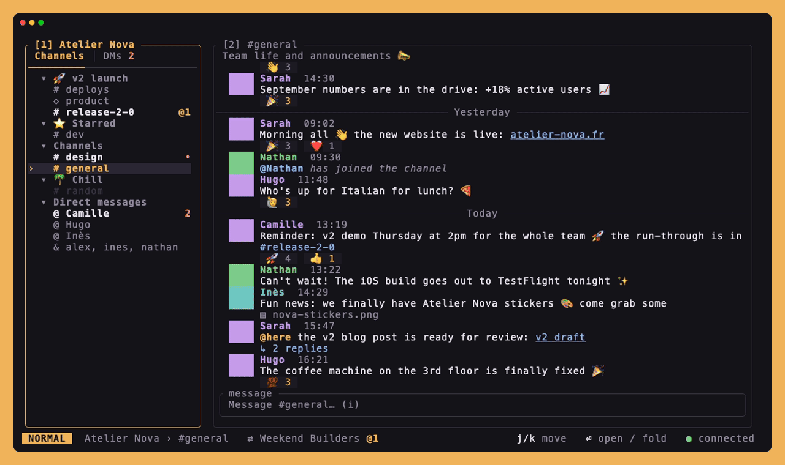
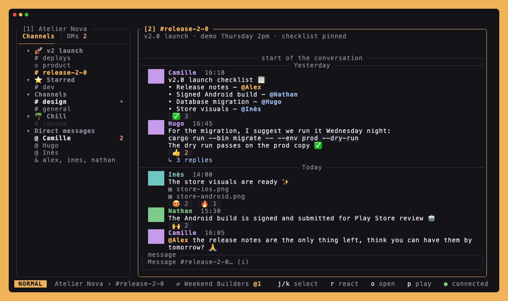
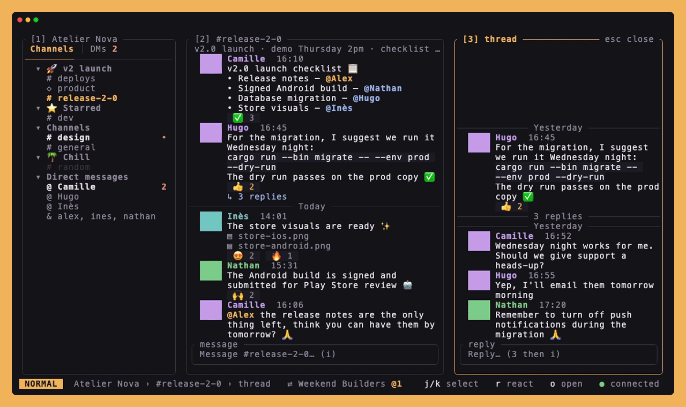
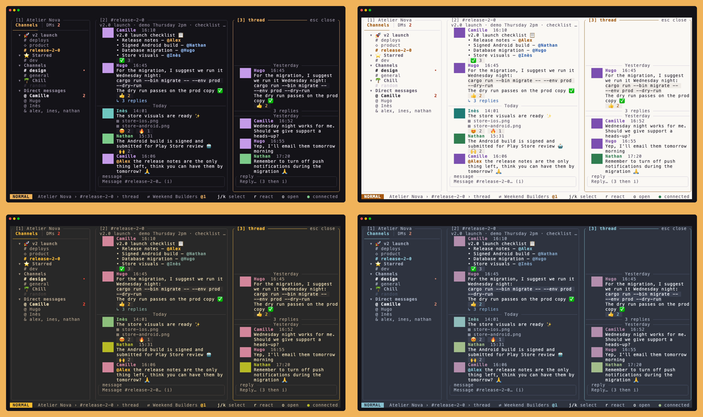

<div align="center">

# slackterm

**Slack, in your terminal.**

Real time, threads, search, sections: all from the keyboard, without leaving your shell.

[](https://github.com/simoncdna/slackterm/actions/workflows/ci.yml)
[](https://github.com/simoncdna/slackterm/releases/latest)




<sub>Everything shown here runs on a made-up workspace: <code>slackterm demo</code>, no Slack account needed.</sub>

<br><br>

<a href="docs/media/slackterm.mp4"></a>

<sub>The presentation video, with real profile pictures in the terminal.</sub>

</div>

---

## Why

Slack in the browser is one more tab, a lot of mouse and quite a bit of memory.
slackterm keeps what matters day to day — reading, replying, finding a message, knowing where you're needed — in a light keyboard-driven interface, built to live next to your editor.

- ⚡ **Real time**: messages, edits, deletions and reactions arrive live, with automatic reconnection.
- 🧵 **Threads** in their own pane, to read and reply without losing the channel.
- ✍️ **Mentions** that notify: type `@` or `#` and slackterm suggests people, `@here` and channels.
- 🗂️ **Your Slack sections** (with their emoji), foldable, and a **DMs** tab sorted by activity.
- 🔎 **Search** through the whole history, with `in:#channel`, `from:@person`, `during:today`…
- 🎯 **Ctrl+K** to jump anywhere in a few letters (fuzzy search), including to someone you never wrote to or a channel you haven't joined.
- 🔔 **Unreads and mentions** picked up from your Slack client at startup, then kept up to date.
- 🎨 **3 layouts, 4 themes** and an accent color, changed live.
- 🖼️ **Avatars**: profile pictures in terminals that can draw images (Kitty, iTerm2, WezTerm, Sixel), colored initials elsewhere.
- 😄 **Reactions** in two keystrokes, and Slack emoji (`:tada:`, skin tones, flags) turned into real emoji.

## Try it without an account

No account needed: demo mode opens a fake workspace, with a team getting version 2 of its app out the door. Messages arrive on their own, and your teammates react to what you write.

```sh
brew install simoncdna/tap/slackterm   # or another way below
slackterm demo
```

Nothing leaves your machine, and your settings are neither read nor changed.

---

## A quick tour

### Get around like in Slack

The sidebar shows the sections you set up in Slack. `Enter` folds a section, but conversations waiting for you (unreads, mentions) stay visible. `←` / `→` switches between **Channels** and **DMs**, where your direct messages are sorted by recent activity. And to go faster: `Ctrl+K`, three letters, `Enter`. It finds everyone in the workspace and every public channel too: pick someone to start a conversation, or a channel to join it.



### Search the whole history

`/` searches messages across the whole workspace, with matching terms highlighted. Opening a result takes you to the message, loading older history if needed; if it's a reply, its thread opens beside it. Slack's filters work: `in:#dev`, `from:@hugo`, `during:today`, `"exact phrase"`.



### React without leaving the keyboard

Select a message, press `r`: the reactions you use most in your conversations come first, and a few letters find any emoji, your workspace's custom ones included. Picking a reaction you already added removes it.



### Three layouts, switched live

`,` opens the settings (layout, theme, accent, avatars, clock): every change applies right away and is saved for next time.



| | Layout | Best for |
|---|---|---|
| **A** | Three panes: sidebar, channel, thread | Closest to Slack, great full screen |
| **B** | Dense IRC-style stream, numbered list | As many messages on screen as possible |
| **C** | Focus: the channel alone, navigate with `Ctrl+K` | A split next to your editor |

### Four themes

**Night**, **Light**, **Gruvbox** and **Nord**, with the accent of your choice (amber, blue, lilac, green). Everyone keeps their color from one message to the next.



---

## Install

**macOS and Linux**, with [Homebrew](https://brew.sh):

```sh
brew install simoncdna/tap/slackterm
```

or with the install script:

```sh
curl --proto '=https' --tlsv1.2 -LsSf https://github.com/simoncdna/slackterm/releases/latest/download/slackterm-installer.sh | sh
```

**Windows**, in PowerShell:

```powershell
powershell -ExecutionPolicy Bypass -c "irm https://github.com/simoncdna/slackterm/releases/latest/download/slackterm-installer.ps1 | iex"
```

**With Cargo**, if you have [Rust](https://rustup.rs) 1.90 or later:

```sh
cargo install slackterm
```

Prebuilt binaries for every platform are also on the [releases page](https://github.com/simoncdna/slackterm/releases/latest).

## Sign in

```sh
slackterm login
```

slackterm opens Chrome (or Chromium, Brave, Edge) in a dedicated profile: you sign in to your workspace as usual, and it picks up the web session (the `xoxc` token and the `d` cookie). Nothing to create on the Slack side, no app for an admin to approve. The profile is kept, so an expired session usually renews in one click.

Credentials are stored in the system keychain: Keychain on macOS, Credential Manager on Windows, Secret Service (GNOME Keyring, KWallet) on Linux. Where there is none — an SSH session, WSL, a window manager without a keyring — they go to a `session.json` file that only you can read, in the data directory (`~/.local/share/slackterm/` on Linux), and `login` tells you so.

```sh
slackterm              # open the interface
slackterm status       # check that the session is still valid
slackterm logout       # delete the credentials
```

| `login` option | |
|---|---|
| `--manual` | Paste the token and cookie yourself, copied from the DevTools |
| `--browser <PATH>` | Use another Chromium-based browser |
| `--timeout <SECONDS>` | How long you have to sign in (300 by default) |

> [!NOTE]
> slackterm uses the web client's session and a few undocumented APIs (`client.counts`, `users.channelSections.list`), just like the Slack app does. Make sure this is allowed by your workspace's policies.

---

## Keys

`?` lists every key, the status bar always shows the ones that matter where you are, and all of them can be [changed](#keys-1).

**Everywhere**

| Key | Action |
|---|---|
| `?` | All the keys |
| `Ctrl+K` | Go to a channel or a person |
| `/` or `Ctrl+F` | Search messages |
| `,` | Settings (layout, theme, accent, avatars, clock) |
| `Tab` / `Shift+Tab` | Next / previous pane |
| `1` `2` `3` | Sidebar, messages, thread |
| `q` or `Ctrl+C` | Quit |

**Sidebar**

| Key | Action |
|---|---|
| `j` `k` or `↓` `↑` | Move |
| `g` / `G` | Top / bottom |
| `h` `l`, `←` `→` or `[` `]` | Channels / DMs tab |
| `Enter` or `Space` | Open the conversation, fold the section |

**Messages**

| Key | Action |
|---|---|
| `j` `k` or `↓` `↑` | Select a message (going past the oldest one loads more) |
| `PgUp` / `PgDn` | Previous / next page |
| `g` / `G` | First message / back to the bottom |
| `t` | Open the message's thread |
| `r` | React to the message (in threads too) |
| `e` | Edit your message: the selected one, else your latest |
| `d` | Delete your message, after confirming |
| `o` | Open the message's files |
| `p` | Play the message's video in the terminal (needs [mpv](https://mpv.io), and [yt-dlp](https://github.com/yt-dlp/yt-dlp) for links) |
| `i`, `a` or `Enter` | Write |
| `Esc` | Deselect, close the thread |

**While writing**

| Key | Action |
|---|---|
| `Enter` | Send |
| `@` or `#`, then `Tab` or `Enter` | Mention someone, `@here` or a channel, picked from the suggestions |
| `Shift+Enter`, `Alt+Enter` or `Ctrl+J` | New line |
| `Ctrl+A` / `Ctrl+E` | Start / end of line |
| `Ctrl+W` or `Alt+Backspace` | Delete the previous word |
| `Ctrl+U` | Clear everything |
| `Esc` | Back to normal mode |

## Configuration

```sh
slackterm config             # open the config file in $VISUAL or $EDITOR
slackterm config --default   # print every option with its default value
slackterm config --path      # print where the file is
```

The first `slackterm config` creates the file with every option commented out, and once you close your editor it checks what you wrote. The file is `config.toml` in:

- `~/.config/slackterm/` on Linux, and on macOS if you create it there;
- `~/Library/Application Support/slackterm/` on macOS otherwise;
- `%APPDATA%\slackterm\config\` on Windows;
- `$XDG_CONFIG_HOME/slackterm/` wherever that variable is set.

`--config <PATH>` uses another file.

### Settings

The settings screen (`,`) changes these live and writes them to the file, keeping your comments and the rest of it.

```toml
layout = "panels"   # panels | stream | focus
theme = "night"     # night | light | gruvbox | nord
accent = "theme"    # theme | amber | blue | lilac | green
avatars = "images"  # images | initials | off
clock = "24h"       # 24h | 12h
```

### Keys

Every key of normal mode can be changed in `[keys]`, by action: give one key, a list, or `[]` for none. The status bar, the help (`?`) and the hints in the message box follow your keys, and a key given to two actions is reported when slackterm starts.

```toml
[keys]
react = "e"
search = ["/", "ctrl+s"]
down = ["j", "ctrl+n", "down"]
up = ["k", "ctrl+p", "up"]
play = []
```

A key is a character (`"q"`, `"G"`, `"?"`) or a name: `enter`, `esc`, `tab`, `space`, `backspace`, `delete`, `up`, `down`, `left`, `right`, `home`, `end`, `pageup`, `pagedown`, `f1` to `f12`; put `ctrl+`, `alt+` or `shift+` in front for combinations. `slackterm config --default` lists every action with its keys. The keys of the message box (`Enter` to send, `Ctrl+W`…) stay as they are.

### Colors

`[colors]` replaces any color of the theme, with `"#rrggbb"`, a terminal color name such as `"red"`, a palette index such as `"42"`, or `"reset"` for the terminal's own color.

```toml
[colors]
accent = "#88c0d0"
bg = "reset"        # the terminal's background, transparency included
```

`slackterm config --default` lists them all: background, text, borders, links, unread counts, and the colors given to people.

Folded sections and the open tab are remembered separately, in `sidebar.toml`.

---

## Under the hood

- **Rust + [ratatui](https://ratatui.rs)**, on the **tokio** runtime.
- **Elm-style architecture**: all the logic goes through `update(app, event) -> Vec<Command>`, which returns the side effects to run instead of running them. So it can be tested without Slack, and demo mode is just another executor plugged into the same interface.
- **Real time** through the `rtm.connect` websocket, with pings and reconnection with backoff.

```
src/
├── auth/        sign-in through the browser (Chrome DevTools Protocol) or by hand
├── slack/       HTTP client, real-time websocket, mrkdwn, emoji
└── tui/
    ├── update/  all the logic: keys, overlays, events
    ├── ui/      drawing: three layouts, sidebar, popups
    ├── demo/    the made-up workspace of `slackterm demo`
    └── executor.rs  runs commands against the Slack API
```

### Re-recording the videos

The animations in this README are [VHS](https://github.com/charmbracelet/vhs) scripts played on demo mode: one command regenerates them after any change to the interface. The presentation video is edited separately with [Remotion](https://www.remotion.dev).

```sh
brew install vhs
docs/record.sh          # every video
docs/record.sh search   # only docs/tapes/search.tape
```

### Releasing

A version tag builds and publishes everything with [cargo-dist](https://github.com/axodotdev/cargo-dist): binaries for macOS, Linux and Windows on GitHub Releases, the install scripts and the Homebrew formula.

```sh
# bump `version` in Cargo.toml and commit, then:
git tag v0.2.0 && git push origin v0.2.0
cargo publish
```

## License

Licensed under either of [Apache License, Version 2.0](LICENSE-APACHE) or [MIT license](LICENSE-MIT), at your option.

Unless you explicitly state otherwise, any contribution intentionally submitted for inclusion in slackterm by you, as defined in the Apache-2.0 license, shall be dual licensed as above, without any additional terms or conditions.
